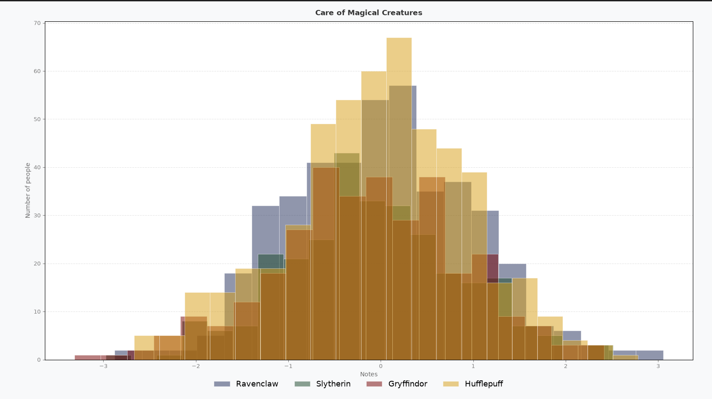
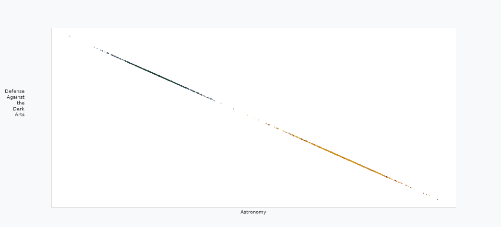

# DSLR: Data Science × Logistic Regression

Built a machine learning classifier from scratch in Python: hand-coded data analysis, charts, and prediction model with over 98% accuracy.
*This project has been created as part of the 42 curriculum by pchalmin and tle-floc.*

[](pyproject.toml)
[](LICENSE)
[](https://conventionalcommits.org)

## Too Long; Didn't Read

- **Problem:** Classify 1,600 students into 4 houses using 13 course grades (with missing values and redundant features).
- **Built from scratch:** Summary statistics (`describe`), data standardization, and a one-vs-all logistic regression trained via gradient descent — using `pandas` only for CSV I/O and `matplotlib` for plotting.
- **Result:** **98.11% accuracy** on the validation split, vs. a 25% random baseline (and within 0.5% of `scikit-learn`'s `LogisticRegression`).

## Results

| Model | Features | Accuracy (mean ± std) |
| ----- | -------- | --------------------- |
| Ours, one-vs-all | 4 | 98.11 ± 0.81 |
| Ours, softmax | 4 | 98.14 ± 0.82 |
| scikit-learn `LogisticRegression`, one-vs-all | 4 | 98.12 ± 0.80 |
| scikit-learn `LogisticRegression`, softmax | 4 | 98.14 ± 0.80 |

Reproduce:
```bash
uv run src/scikitlearn_compare.py
```

## Quick start
Requirements: Python ≥ 3.11 and [uv](https://docs.astral.sh/uv/).

Datasets: `dataset_train.csv` and `dataset_test.csv`

```bash
uv sync
```

```bash
uv run src/logreg_train.py -f dataset_train.csv
```

```bash
uv run src/logreg_predict.py dataset_test.csv
```

The predictions are written to `houses.csv`.

## How it works

```
dataset_train.csv ─► cleaning ─► standardization ─► gradient descent ─► weights.csv
                                                                            │
dataset_test.csv ──► same features, same mean/std ─────────────────────────► houses.csv
```

| Path | Role |
| ---- | ---- |
| `src/describe.py` | Implement the `describe` function  |
| `src/histogram.py`, `src/scatter_plot.py`, `src/pair_plot.py` | Analyze the data and visualize it to answer the questions in the topic. |
| `src/logreg_train.py`, `src/logreg_predict.py` | Start the train or the predict with the desired parameters |
| `src/model/` | Function for our model |
| `src/utils/` | All utility functions for the project |
| `src/scikitlearn_compare.py` | Compare our project to the machine learning library function |
| `tests/` | Testing Our Code  |

## Data exploration

### Which course has a homogeneous score distribution between the four houses?

**Visual Answer:**
A substance is homogeneous when the distribution of its properties is the same regardless of the House. Like this pictures:



**Maths Answer:**
Calculation of a homogeneity score defined as variance plus the standard deviation. The smaller this score, the more homogeneous the subject is.

### Which two features are similar?
**Visual Answer:**
The closer the scatter plot forms a line, the greater the similarity between the two subjects.



**Maths Answer:**
Using the ***Pearson correlation coefficient*** to determine the similarity between two subjects.

### Which features are used for the logistic regression, and why?
**Visual Answer:**
When selecting features, we will choose the clusters that form four distinct groups of houses:


## Design decisions

<!-- Ce qu'un lead technique cherche : tu as choisi, tu sais ce que tu as écarté et pourquoi.
     Garde 4 à 6 lignes. Amorces ci-dessous, à remplir ou à remplacer. Une ligne honnête
     (« choix par défaut, je le referais autrement ») vaut mieux qu'une justification inventée. -->

| Decision | Alternative considered | Why |
| -------- | ---------------------- | --- |
| One `LogisticRegression` class taking a binary or multinomial model | TODO | TODO |
| One-vs-all and softmax both available | TODO | TODO |
| Mean and standard deviation stored in the weights file | TODO | TODO |
| Missing values: rows dropped for training, mean-imputed for prediction | TODO | TODO |
| Early stopping on the loss | TODO | TODO |
| 4 features by default instead of all 13 | TODO | TODO |

## What We learned

### Maths and machine learning

#### Logistic regression
##### Definition

Logistic regression is a supervised binary classification algorithm. Unlike the perceptron (boolean output) or linear regression (numeric output), it predicts a probability.

It has two phases:
- **Training**: fit the parameters on known observations to separate classes 0 and 1 while minimizing the error.
- **Prediction**: classify unseen observations; the model no longer changes.

##### Sigmoid function

$$
f(x) = \frac{1}{1 + e^{-x}}
$$

##### Activation function

Like the perceptron, logistic regression uses a neuron computing:
$$
z(x) = x\beta + θ
$$
where $x$ is the observation row vector, $\beta$ the weight column vector, and $θ$ the bias.

The sigmoid activation $a$ maps $z$ to a probability of belonging to class 1, approaching 0 or 1 away from the decision boundary.

##### Bernoulli distribution

$$
\begin{align}
P(Y = 1) &= a(z) \\
P(Y = 0) &= 1 - a(z)
\end{align}
$$

So:
$$
P(Y = y) = a(z)^y * (1 - a(z))^{1- y}
$$
with $y = \{0,\ 1\}$.

##### Likelihood

Likelihood measures how well predictions agree with the true labels: predicting class 1 with 90% probability on a $Y=1$ example gives 0.9 likelihood for that example. We multiply the probabilities rather than averaging them, so wrong predictions penalize the whole model:

$$
L = \prod_{i=1}^n P(Y = y_i)
$$

Since probabilities follow a Bernoulli distribution:

$$
L = \prod_{i=1}^n a_i^{y_i}  (1 - a_i)^{1 - y_i}
$$

A product of many probabilities tends to 0, so we seek the maximum likelihood rather than 100%. Numerical underflow on large datasets is avoided by taking the natural log — monotonic, hence order-preserving — which also simplifies differentiation:

$$
\begin{align}
ln(L) &= ln\left(\prod_{i=1}^n a_i^{y_i}  (1 - a_i)^{1 - y_i}\right) \\
ln(L) &= \sum_{i=1}^n ln\left(a_i^{y_i}  (1 - a_i)^{1 - y_i}\right) \\
ln(L) &= \sum_{i=1}^n ln\left(a_i^{y_i} \right) + ln\left((1 - a_i)^{1 - y_i}\right) \\
ln(L) &= \sum_{i=1}^n y_i * ln(a_i) + (1 - y_i) * ln(1 - a_i) \\
\end{align}
$$

##### Cost function and Log Loss

Maximizing likelihood is equivalent to minimizing error, i.e. minimizing its negative:

$$
-ln(L) = -\sum_{i=1}^n y_i * ln(a_i) + (1 - y_i) * ln(1 - a_i)
$$

Normalizing by $n$ gives Log Loss:

$$
\mathcal{L} = - \frac{1}{n} \sum_{i=1}^n y_i * ln(a_i) + (1 - y_i) * ln(1 - a_i)
$$

It is differentiable everywhere and convex (no local minima where gradient descent could get stuck). Its value is mainly a health check; training uses its derivative.

##### Gradient

The gradient of the cost gives the direction of steepest increase; only $β$ and $θ$ vary, while $X$ and $Y$ are fixed observations.

$$
\mathcal{L} = - \frac{1}{n} \sum_{i=1}^n y_i * ln(a_i) + (1 - y_i) * ln(1 - a_i)
$$
$$
a(z) = \frac{1}{1 + e^{-z}}
$$
$$
z(x) = x\beta + θ
$$

$$
\begin{align}
\text{ Soit } u &= 1 - a \\
\text{ Soit } v &= ln(u) \\
\frac{\partial v}{\partial a} &= \frac{\partial v}{\partial u} * \frac{\partial u}{\partial a} \\
\frac{\partial v}{\partial a} &= \frac{1}{u} * (-1) \\
\frac{\partial v}{\partial a} &= \frac{-1}{1 - a} \\
\\
\text{ Soit } w &= y * ln(a) + (1 - y) * ln(1 - a) \\
\frac{\partial w}{\partial a} &= y *  \frac{1}{a} + (1 - y) * \frac{\partial v}{\partial a} \\
\frac{\partial w}{\partial a} &= \frac{y}{a} + (1 - y) * \frac{-1}{1 - a} \\
\frac{\partial w}{\partial a} &= \frac{y}{a} + \frac{y - 1}{1 - a} \\
\\
\frac{\partial \mathcal{L}}{\partial a} &= - \frac{1}{n} \sum_{i=1}^n \frac{\partial w_i}{\partial a_i} \\
\frac{\partial \mathcal{L}}{\partial a} &= - \frac{1}{n} \sum_{i=1}^n \frac{y_i}{a_i} + \frac{y_i - 1}{1 - a_i} \\
\end{align}
$$

$$
\begin{align}
\text{ Soit } u &= -z \\
\text{ Soit } v &= 1 + e^u \\
\frac{\partial a}{\partial z} &= \frac{-1}{v^2} * e^u * (-1) \\
\frac{\partial a}{\partial z} &= \frac{1}{v^2} * (1 + e^u - 1) \\
\frac{\partial a}{\partial z} &= \frac{1}{v^2} * (v - 1) \\
\frac{\partial a}{\partial z} &= \frac{1}{v} * \frac{v - 1}{v} \\
\frac{\partial a}{\partial z} &= a \left(\frac{v}{v} - \frac{1}{v}\right) \\
\frac{\partial a}{\partial z} &= a (1 - a) \\
\end{align}
$$

$$
\begin{align}
\frac{\partial z}{\partial \beta_j} &= x_j \\
\end{align}
$$

Gradient with respect to $\beta$:

$$
\begin{align}
\frac{\partial \mathcal{L}}{\partial \beta_j} &= \frac{\partial \mathcal{L}}{\partial a} * \frac{\partial a}{\partial z} * \frac{\partial z}{\partial \beta_j} \\
\frac{\partial \mathcal{L}}{\partial \beta_j} &= - \frac{1}{n} \sum_{i=1}^n \left(\frac{y_i}{a_i} + \frac{y_i - 1}{1 - a_i}\right) * a_i (1 - a_i) * x_j \\
\frac{\partial \mathcal{L}}{\partial \beta_j} &= - \frac{1}{n} \sum_{i=1}^n \left(\frac{y_i a_i (1 - a_i)}{a_i} + \frac{(y_i - 1) a _i(1 - a_i)}{1 - a_i}\right) * x_j \\
\frac{\partial \mathcal{L}}{\partial \beta_j} &= - \frac{1}{n} \sum_{i=1}^n [y_i  (1 - a_i) + (y_i - 1) * a _i] * x_j \\
\frac{\partial \mathcal{L}}{\partial \beta_j} &= - \frac{1}{n} \sum_{i=1}^n [y_i - y_i a_i + y_i a _i - a _i] * x_j \\
\frac{\partial \mathcal{L}}{\partial \beta_j} &= - \frac{1}{n} \sum_{i=1}^n (y_i - a _i) * x_j \\
\frac{\partial \mathcal{L}}{\partial \beta_j} &= \frac{1}{n} \sum_{i=1}^n (a _i - y_i) * x_j \\
\end{align}
$$

By the same derivation for $θ$:

$$
\begin{align}
\frac{\partial z}{\partial \beta_j} &= 1 \\
\end{align}
$$

$$
\begin{align}
\frac{\partial \mathcal{L}}{\partial θ} &= \frac{\partial \mathcal{L}}{\partial a} * \frac{\partial a}{\partial z} * \frac{\partial z}{\partial θ} \\
\frac{\partial \mathcal{L}}{\partial θ} &= - \frac{1}{n} \sum_{i=1}^n \left(\frac{y_i}{a_i} + \frac{y_i - 1}{1 - a_i}\right) * a_i (1 - a_i) * 1 \\
\frac{\partial \mathcal{L}}{\partial θ} &= \frac{1}{n} \sum_{i=1}^n (a _i - y_i) \\
\end{align}
$$

##### Vectorization

Whole datasets are handled as vectors and matrices:

$$
Z(X) = X\beta + θ
$$
with:
$$
X =
\begin{pmatrix}
x_{11} & ... & x_{1K}\\
x_{21} & ... & x_{2K}\\
... & ... & ...\\
x_{n1} & ... & x_{nK}\\
\end{pmatrix} ;

\beta = \begin{pmatrix}
\beta_{1} \\
\beta_{2} \\
... \\
\beta_{K} \\
\end{pmatrix} ;

θ\ \epsilon\ \mathbb{R}
$$

Shapes: $Z\ (n,1)$, $X\ (n,K)$, $\beta\ (K,1)$, $θ$ scalar (broadcast).

$$
A(Z) = \frac{1}{1 + e^{-Z}}
$$
with $Z\ (n,1)$ and $A\ (n,1)$.

Cost function:

$$
\begin{align}
\mathcal{L} &= - \frac{1}{n} \sum_{i=1}^n \left[y_i * ln(a_i) + (1 - y_i) * ln(1 - a_i)\right] \\
\mathcal{L} &= - \frac{1}{n} ([y_1 * ln(a_1) + ... + y_n * ln(a_n)] + [(1 - y_1) * ln(1 - a_1) + ... + (1 - y_n) * ln(1 - a_n)]) \\
\mathcal{L} &= - \frac{1}{n} \sum \left[Y \odot ln(A) + (1 - Y) \odot ln(1 - A)\right]
\end{align}
$$

$\odot$ is the Hadamard (element-wise) product; the sum reduces the $(n,1)$ vector to a scalar, equivalently written as:

$$
\mathcal{L} = - \frac{1}{n} 1^T \left[Y \odot ln(A) + (1 - Y) \odot ln(1 - A)\right]
$$

The $\beta$ gradients form the Jacobian:

$$
\begin{align}
\frac{\partial \mathcal{L}}{\partial \beta} &= \begin{pmatrix}
\frac{\partial \mathcal{L}}{\partial \beta_1} \\
... \\
\frac{\partial \mathcal{L}}{\partial \beta_K} \\
\end{pmatrix} \\ \\
\frac{\partial \mathcal{L}}{\partial \beta} &= \begin{pmatrix}
\frac{1}{n} \sum_{i=1}^n (a _i - y_i) * x_1 \\
... \\
\frac{1}{n} \sum_{i=1}^n (a _i - y_i) * x_K \\
\end{pmatrix} \\ \\
\frac{\partial \mathcal{L}}{\partial \beta} &= \frac{1}{n} \begin{pmatrix}
\sum_{i=1}^n (a _i - y_i) * x_1 \\
... \\
 \sum_{i=1}^n (a _i - y_i) * x_K \\
\end{pmatrix} \\ \\
\frac{\partial \mathcal{L}}{\partial \beta} &= \frac{1}{n} X^T \cdot (A - Y)
\end{align}
$$
with shapes $(K,1)$, $(K,n)$, $(n,1)$, $(n,1)$.

$θ$ and its gradient are scalars:

$$
\begin{align}
\frac{\partial \mathcal{L}}{\partial θ} &= \frac{1}{n}  \sum (A - Y)
\end{align}
$$
with $A\ (n,1)$ and $Y\ (n,1)$. Equivalently:

$$
\begin{align}
\frac{\partial \mathcal{L}}{\partial θ} &= \frac{1}{n}  1^T (A - Y)
\end{align}
$$

##### Gradient descent

Gradient descent moves in the opposite direction of the gradient to minimize the cost, iteratively. It is defined by a number of iterations and a learning rate $\alpha$; $β$ and $θ$ can start at zero or random values.

$$
\begin{align}
\beta' &= \beta - \alpha \frac{\partial \mathcal{L}}{\partial \beta} \\
\beta' &= \beta - \alpha \frac{1}{n} X^T \cdot (A - Y)\\
\end{align}
$$

$$
\begin{align}
θ' &= θ - \alpha \frac{\partial \mathcal{L}}{\partial θ} \\
θ' &= θ - \alpha \frac{1}{n}  \sum (A - Y)\\
\end{align}
$$

##### Learning rate

$\alpha$ is usually set to 0.01. Too small: training needs many more iterations. Too large: the minimum is overshot and the error grows instead of decreasing.

##### Alternative formulation

$$
\begin{align}
z(x) &= x\beta + θ \\
z(x) &= x_1 \beta_1 + ... + x_n \beta_n + θ \\
z(x) &= x_1 \beta_1 + ... + x_n \beta_n + 1θ \\
z(x) &= 1θ + x_1 \beta_1 + ... + x_n \beta_n \\
z(x) &= (1, x) \cdot (θ, \beta) \\
\end{align}
$$

Folding the bias into the weight vector and adding a 1 to $x$ gives:

$$
X =
\begin{pmatrix}
1 & x_{11} & ... & x_{1K}\\
1 & x_{21} & ... & x_{2K}\\
1  & ... & ... & ...\\
1 &x_{n1} & ... & x_{nK}\\
\end{pmatrix} ;
\beta = \begin{pmatrix}
θ \\
\beta_{1} \\
\beta_{2} \\
... \\
\beta_{K} \\
\end{pmatrix}
$$

### Engineering

<!-- Qu'est-ce que mypy --strict, les tests et les hooks pre-commit t'ont fait attraper concrètement ?
     Qu'est-ce que le travail à deux a changé (revue, conventions de commit, découpage) ? -->
TODO

## Limitations and next steps

<!-- Nommer ses limites soi-même, c'est ce que fait un professionnel. Pistes issues de l'audit :
     - pas de jeu de validation ni de métrique dans le pipeline principal ;
     - dataset jouet, 4 classes bien séparées : le score élevé ne dit rien de la difficulté ;
     - early stopping fragile avec sgd/minibatch ;
     - Momentum et Adam non implémentés ;
     - pas de test sur la descente de gradient elle-même.
     Pour chaque limite : une phrase sur ce que tu ferais. -->
- TODO

### Bonus
- More fields for describe [x]
- How to answer at : Which Hogwarts course has a homogeneous score distribution between all four houses ? [x]
- How to answer at : What are the two features that are similar ? [x]
- How to answer at : From this visualization, which features are you going to use for your logistic regression ? [x]
- Stochiastic Gradient Descent [x]
- Mini Batch [x]
- Soft - Max [x]
- Early Stopping [x]
- Plot cost [x]

## Usage reference

<details>
<summary>Describe</summary>

Display statistics for all numerical features of a dataset:
```bash
uv run src/describe.py dataset_train.csv
```

'''bash
bash-5.3$ uv run src/describe.py dataset_train.csv 
              Index     Arithmancy  ...       Charms       Flying
count    1600.00000    1566.000000  ...  1600.000000  1600.000000
mean      799.50000   49634.570243  ...  -243.374409    21.958012
std       462.02453   16679.806036  ...     8.783640    97.631602
min         0.00000  -24370.000000  ...  -261.048920  -181.470000
25%       399.75000   38511.500000  ...  -250.652600   -41.870000
50%       799.50000   49013.500000  ...  -244.867765    -2.515000
75%      1199.25000   60811.250000  ...  -232.552305    50.560000
max      1599.00000  104956.000000  ...  -225.428140   279.070000
etendue  1599.00000  129326.000000  ...    35.620780   460.540000
nan         0.00000      34.000000  ...     0.000000     0.000000

[10 rows x 14 columns]
'''

</details>

<details>
<summary>Visualization</summary>

The three scripts read `dataset_train.csv` from the current directory.

```bash
uv run src/histogram.py [-s SUBJECT | -a | -f]
uv run src/scatter_plot.py [-s1 SUBJECT -s2 SUBJECT | -a | -f]
uv run src/pair_plot.py
```

| Option | Effect |
| ------ | ------ |
| `-s`, `-s1`/`-s2` | Plot the given course(s) |
| `-a`, `--auto` | Let the program pick the answer (most homogeneous course / most correlated pair) |
| `-f`, `--full` | Plot every course |

</details>

<details>
<summary>Training</summary>

Train the one-vs-all classifiers (default) or a single softmax classifier:

```bash
uv run src/logreg_train.py -f dataset_train.csv
uv run src/logreg_train.py -f dataset_train.csv --softmax
```

| Option | Default | Effect |
| ------ | ------- | ------ |
| `-f`, `--file` | `dataset_train.csv` | Training dataset |
| `--softmax` | off | Train one softmax classifier instead of one-vs-all |
| `--features` | `Astronomy,Herbology,Defense Against the Dark Arts,Ancient Runes` | Comma-separated list of columns to train on |
| `--optimizer` | `none` | `none`, `batch`, `sgd` or `minibatch` Trades smooth convergence for faster iterations and scalability to large datasets via configurable |
| `--alpha` | `0.1` | Learning rate |
| `--iteration` | `10000` | Maximum number of passes over the dataset |
| `--batch_size` | `32` | Batch size for `minibatch` |
| `--seed` | none | Seed for the stochastic optimizers |
| `--output` | `weights.csv` / `weights_softmax.csv` | Weights file |
| `-d`, `--display` | off | Plot the loss evolution |

```bash
uv run src/logreg_train.py -f dataset_train.csv --features "Astronomy,Herbology,Charms"
```

The selected features are stored in the weights file, so the prediction automatically uses the same ones.

</details>

<details>
<summary>Prediction</summary>

Predict with the one-vs-all weights (default) or with the softmax weights:

```bash
uv run src/logreg_predict.py -f dataset_test.csv
uv run src/logreg_predict.py -f dataset_test.csv --softmax
```

The weights are read from `weights.csv` (or `weights_softmax.csv`) in the current directory. The predictions are
written to `houses.csv`, or to `--output <file>`.

</details>

## Development

| Tool | Role |
| ---- | ---- |
| `uv` | Environment and dependency management |
| `pytest` | Unit tests |
| `mypy --strict` | Static type checking |
| `ruff format` / `ruff check` | Formatter / linter |
| Husky, Commitizen, Commitlint | Git hooks and commit convention |
| Nix | Reproducible development shell |

```bash
uv run pytest
```

```bash
uv run mypy src/
```

```bash
uv run ruff check . && uv run ruff format --check .
```

The same four checks run on every push and pull request (see [ci.yml](.github/workflows/ci.yml)).

The tests (in the tests/ directory) cover 5 areas:
- test_math.py — custom statistical functions: mean, median (even/odd), Q1/Q3 quartiles, standard deviation, Pearson's correlation.
- test_stats.py — get_stats (describe): count, mean, std, min/max, quartiles, range, NaN; compared to pandas for single- and multi-column data, negative/decimal values, and duplicates.
- test_file_handling.py — load_csv/write_csv: valid cases + errors (file extension, file not found, permissions, empty file, malformed columns, invalid path).
- test_training_set.py — construction of training sets (one-vs-all and softmax): feature selection; unknown feature → explicit error.
- test_prediction.py — softmax prediction: house with the maximum logit; imputing NaNs with the mean; missing feature or missing weight column → error.

### With Nix

[Nix](https://nixos.org/) is a package manager that provides a reproducible, declarative development environment.

Shell with the runtime tools (Python, uv):
```bash
nix develop
```

Shell with the development tools as well (linter, formatter, Node for the commit hooks):
```bash
nix develop .#dev
```

### Commit

This repository uses [Conventional Commits](https://conventionalcommits.org),
enforced by [Husky](https://typicode.github.io/husky/), [Commitizen](https://commitizen-tools.github.io/commitizen/) and [Commitlint](https://commitlint.js.org/).

```bash
npm install
```

```bash
npm run commit
```

The `pre-commit` hook runs the type checker, the unit tests, the formatter and the linter, and rejects the commit
if one of them fails. The `commit-msg` hook rejects the commit when the message does not follow the convention.

## Team and contributions


| Author | Main contributions |
| ------ | ------------------ |
| pchalmin | TODO |
| tle-floc | TODO |


## Resources

**Maths**
[Wikipedia - Logistic regression](https://en.wikipedia.org/wiki/Logistic_regression)
[Wikipedia - Linear regression](https://en.wikipedia.org/wiki/Linear_regression)
[Wikipedia - Gradient](https://en.wikipedia.org/wiki/Gradient)
[Wikipedia - Gradient descent](https://en.wikipedia.org/wiki/Gradient_descent)
[Wikipedia - Sigmoid function](https://en.wikipedia.org/wiki/Sigmoid_function)
[Wikipedia - Stochastic gradient descent](https://en.wikipedia.org/wiki/Stochastic_gradient_descent)
[Wikipedia - Pearson correlation coefficient](https://en.wikipedia.org/wiki/Pearson_correlation_coefficient)

**Courses (French)**
[Progresser en maths - Le gradient d’une fonction](https://progresser-en-maths.com/gradient-cours-et-applications-ml/)
[Progresser en maths - La descente de gradient](https://progresser-en-maths.com/descente-de-gradient-cours-et-implementation/)
[Progresser en maths - La fonction sigmoïde](https://progresser-en-maths.com/la-fonction-sigmoide-cours-et-exercices-corriges/)
[Progresser en maths - La régression logistique](https://progresser-en-maths.com/la-regression-logistique-cours-complet-maths-et-implementation-python/)
[Progresser en maths - La régression linéaire](https://progresser-en-maths.com/la-regression-lineaire-cours-complet-maths-et-implementation-python/)

**Visualization**
[GeeksfoGeeks - Pair Plot in Matplotlib](https://www.geeksforgeeks.org/python/pairplot-in-matplotlib/)

## License

Released under the [MIT License](LICENSE).