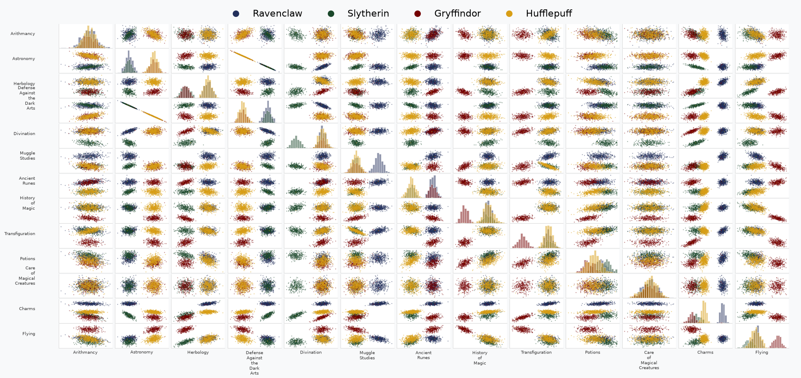

# DSLR: Data Science × Logistic Regression

A machine learning classifier built from scratch in Python: hand-coded data analysis, charts, and a prediction model with over 98% accuracy.
*This project has been created as part of the 42 curriculum by pchalmin and tle-floc.*

[](pyproject.toml)
[](LICENSE)
[](https://conventionalcommits.org)

## Too Long; Didn't Read

- **Problem:** Classify 1,600 students into 4 houses using 13 course grades (with missing values and redundant features).
- **Built from scratch:** Summary statistics (`describe`), data standardization, and a logistic regression (one-vs-all or softmax) trained via gradient descent. `pandas` only stores and manipulates the tables (CSV I/O, missing-value filtering, grouping), never computes a statistic or a model step; `matplotlib` is used for plotting.
- **Result:** **98.11% accuracy** in cross-validation, vs. a 25% random baseline, on par with `scikit-learn`'s `LogisticRegression` (98.12%).

## Results

Accuracy (%) over a stratified 5-fold cross-validation repeated 4 times (20 runs) on `dataset_train.csv`:

| Model | Features | Accuracy (mean ± std) |
| ----- | -------- | --------------------- |
| Ours, one-vs-all | 4 | 98.11 ± 0.81 |
| Ours, softmax | 4 | 98.14 ± 0.82 |
| scikit-learn `LogisticRegression`, one-vs-all | 4 | 98.12 ± 0.80 |
| scikit-learn `LogisticRegression`, softmax | 4 | 98.14 ± 0.80 |

To compare the models on equal terms, this script fills the missing values with the training-fold median for all four models. It therefore differs from `logreg_train.py`, which drops incomplete rows, and from `logreg_predict.py`, which fills them with the mean.

Reproduce:
```bash
uv run src/scikitlearn_compare.py
```

## Contents
- [Quick start](#quick_start)
- [How it works](#how_it_works)
- [Data exploration](#data_exploration)
- [Design decisions](#design_decisions)
- [What we learned](#what_we_learned)
- [Bonus](#bonus)
- [Usage reference](#usage_reference)
- [Development](#development)
- [Resources](#resources)
- [License](#license)

## Quick start
Requirements: Python ≥ 3.11 and [uv](https://docs.astral.sh/uv/).

Datasets: place `dataset_train.csv` and `dataset_test.csv` (provided with the 42 subject) at the root of the repository; the scripts read them from the current directory.

```bash
uv sync
```

```bash
uv run src/logreg_train.py dataset_train.csv
```

```bash
uv run src/logreg_predict.py dataset_test.csv
```

The predictions are written to `houses.csv`.

## How it works

```
dataset_train.csv ─► cleaning ─► standardization ─► gradient descent ─► weights.csv
                                                                            │
dataset_test.csv ──► same features, same mean/std ─────────────────────────► houses.csv
```

| Path | Role |
| ---- | ---- |
| `src/describe.py` | Hand-coded equivalent of pandas' `describe` |
| `src/histogram.py`, `src/scatter_plot.py`, `src/pair_plot.py` | Explore and visualize the data to answer the questions of the subject |
| `src/logreg_train.py`, `src/logreg_predict.py` | Run the training or the prediction with the desired parameters |
| `src/model/` | Logistic regression model (binary and multinomial) |
| `src/utils/` | Utility functions shared across the project |
| `src/scikitlearn_compare.py` | Compare our model with scikit-learn's `LogisticRegression` |
| `tests/` | Unit tests |

## Data exploration

### Which course has a homogeneous score distribution between the four houses?

**Visual answer:**
A course is homogeneous when its score distribution is the same whatever the house, as in this histogram:


**Maths answer:**
Each course is standardized (z-score), then we compute the mean and the standard deviation of each house. The homogeneity score is the variance of the four means plus the variance of the four standard deviations. The lower the score, the more homogeneous the course.

### Which two features are similar?
**Visual answer:**
The closer the scatter plot is to a straight line, the more similar the two courses.


**Maths answer:**
We use the ***Pearson correlation coefficient*** to measure the similarity between two courses.

### Which features are used for the logistic regression, and why?
**Visual answer:**
We select the features whose scatter plots split the students into four distinct groups, one per house:



## Design decisions

<!-- Ce qu'un lead technique cherche : tu as choisi, tu sais ce que tu as écarté et pourquoi.
     Garde 4 à 6 lignes. Amorces ci-dessous, à remplir ou à remplacer. Une ligne honnête
     (« choix par défaut, je le referais autrement ») vaut mieux qu'une justification inventée. -->

| Decision | Alternative considered | Why |
| -------- | ---------------------- | --- |
| One `LogisticRegression` class taking a binary or multinomial model | TODO | TODO |
| One-vs-all and softmax both available | TODO | TODO |
| Mean and standard deviation stored in the weights file | TODO | TODO |
| Missing values: rows dropped for training, mean-imputed for prediction | TODO | TODO |
| Early stopping on the loss | TODO | TODO |
| 4 features by default instead of all 13 | TODO | TODO |

## What we learned

### Maths and machine learning

#### Logistic regression
##### Definition

Logistic regression is a supervised binary classification algorithm. Unlike the perceptron (boolean output) or linear regression (numeric output), it predicts a probability.

It has two phases:
- **Training**: fit the parameters on known observations to separate classes 0 and 1 while minimizing the error.
- **Prediction**: classify unseen observations; the model no longer changes.

##### Neuron (linear combination)

Like the perceptron, logistic regression uses a neuron computing:

$$
z(x) = x\beta + \beta_0
$$

where $x$ is the observation row vector, $\beta$ the weight column vector, and $\beta_0$ the bias (the intercept).

##### Sigmoid activation

$$
a(z) = \frac{1}{1 + e^{-z}}
$$

The sigmoid activation $a$ maps $z$ to the probability of belonging to class 1. It approaches 0 or 1 as the observation moves away from the decision boundary ($z = 0$).

##### Bernoulli distribution

$$
\begin{aligned}
P(Y = 1) &= a(z) \\
P(Y = 0) &= 1 - a(z)
\end{aligned}
$$

So:

$$
\begin{aligned}
P(Y = y) &= a(z)^y \cdot \left(1 - a(z)\right)^{1 - y} && \text{with } y \in \lbrace 0, 1 \rbrace
\end{aligned}
$$


##### Likelihood

The likelihood measures how well the predictions agree with the true labels: predicting class 1 with a 90% probability on a $Y = 1$ example gives a likelihood of 0.9 for that example. Assuming the examples are independent, the likelihood of the whole dataset is the product of the individual probabilities:

$$
L = \prod_{i=1}^n P(Y = y_i)
$$

Since the probabilities follow a Bernoulli distribution:

$$
L = \prod_{i=1}^n a_i^{y_i} (1 - a_i)^{1 - y_i}
$$

Training seeks the parameters that maximize $L$. But a product of many probabilities quickly tends to 0 and underflows on large datasets, so we maximize its natural log instead: the log is monotonic, hence preserves the maximum, and it turns the product into a sum that is easier to differentiate:

$$
\begin{aligned}
\ln(L) &= \ln\left(\prod_{i=1}^n a_i^{y_i} (1 - a_i)^{1 - y_i}\right) \\
\ln(L) &= \sum_{i=1}^n \ln\left(a_i^{y_i} (1 - a_i)^{1 - y_i}\right) \\
\ln(L) &= \sum_{i=1}^n \ln\left(a_i^{y_i}\right) + \ln\left((1 - a_i)^{1 - y_i}\right) \\
\ln(L) &= \sum_{i=1}^n \left[y_i \ln(a_i) + (1 - y_i) \ln(1 - a_i)\right]
\end{aligned}
$$

##### Cost function and log loss

Maximizing the log-likelihood is equivalent to minimizing its negative, which we use as the cost:

$$
-\ln(L) = -\sum_{i=1}^n \left[y_i \ln(a_i) + (1 - y_i) \ln(1 - a_i)\right]
$$

Normalizing by $n$ gives the log loss:

$$
\mathcal{L} = - \frac{1}{n} \sum_{i=1}^n \left[y_i \ln(a_i) + (1 - y_i) \ln(1 - a_i)\right]
$$

It is differentiable and convex in $\beta$ and $\beta_0$: any local minimum is the global one, so gradient descent cannot get stuck in a bad one. One caveat: when the classes are linearly separable, the cost keeps decreasing as the weights grow and has no finite minimum, which is one reason to stop the training early. Its value is mainly a health check; the training uses its derivative.

##### Gradient

The gradient of the cost gives the direction of steepest increase. Only $\beta$ and $\beta_0$ vary, while $X$ and $Y$ are fixed observations.

$$
\mathcal{L} = - \frac{1}{n} \sum_{i=1}^n \left[y_i \ln(a_i) + (1 - y_i) \ln(1 - a_i)\right]
$$
$$
a(z) = \frac{1}{1 + e^{-z}}
$$
$$
z(x) = x\beta + \beta_0
$$

Derivative of the cost with respect to $a_i$:

$$
\begin{aligned}
\text{Let } u &= 1 - a \\
\text{Let } v &= \ln(u) \\
\frac{\partial v}{\partial a} &= \frac{\partial v}{\partial u} \cdot \frac{\partial u}{\partial a} \\
\frac{\partial v}{\partial a} &= \frac{1}{u} \cdot (-1) \\
\frac{\partial v}{\partial a} &= \frac{-1}{1 - a} \\
\\
\text{Let } w &= y \ln(a) + (1 - y) \ln(1 - a) \\
\frac{\partial w}{\partial a} &= y \cdot \frac{1}{a} + (1 - y) \cdot \frac{\partial v}{\partial a} \\
\frac{\partial w}{\partial a} &= \frac{y}{a} + (1 - y) \cdot \frac{-1}{1 - a} \\
\frac{\partial w}{\partial a} &= \frac{y}{a} + \frac{y - 1}{1 - a} \\
\\
\frac{\partial \mathcal{L}}{\partial a_i} &= - \frac{1}{n} \left(\frac{y_i}{a_i} + \frac{y_i - 1}{1 - a_i}\right)
\end{aligned}
$$

Derivative of the sigmoid:

$$
\begin{aligned}
\text{Let } u &= -z \\
\text{Let } v &= 1 + e^u \\
\frac{\partial a}{\partial z} &= \frac{-1}{v^2} \cdot e^u \cdot (-1) \\
\frac{\partial a}{\partial z} &= \frac{1}{v^2} \cdot (1 + e^u - 1) \\
\frac{\partial a}{\partial z} &= \frac{1}{v^2} \cdot (v - 1) \\
\frac{\partial a}{\partial z} &= \frac{1}{v} \cdot \frac{v - 1}{v} \\
\frac{\partial a}{\partial z} &= a \left(\frac{v}{v} - \frac{1}{v}\right) \\
\frac{\partial a}{\partial z} &= a (1 - a)
\end{aligned}
$$

Derivative of the neuron, where $x_{ij}$ is the value of feature $j$ for observation $i$:

$$
\frac{\partial z_i}{\partial \beta_j} = x_{ij}
$$

Gradient with respect to $\beta_j$ (chain rule, summed over the observations):

$$
\begin{aligned}
\frac{\partial \mathcal{L}}{\partial \beta_j} &= \sum_{i=1}^n \frac{\partial \mathcal{L}}{\partial a_i} \cdot \frac{\partial a_i}{\partial z_i} \cdot \frac{\partial z_i}{\partial \beta_j} \\
\frac{\partial \mathcal{L}}{\partial \beta_j} &= - \frac{1}{n} \sum_{i=1}^n \left(\frac{y_i}{a_i} + \frac{y_i - 1}{1 - a_i}\right) \cdot a_i (1 - a_i) \cdot x_{ij} \\
\frac{\partial \mathcal{L}}{\partial \beta_j} &= - \frac{1}{n} \sum_{i=1}^n \left(\frac{y_i a_i (1 - a_i)}{a_i} + \frac{(y_i - 1) a_i (1 - a_i)}{1 - a_i}\right) \cdot x_{ij} \\
\frac{\partial \mathcal{L}}{\partial \beta_j} &= - \frac{1}{n} \sum_{i=1}^n \left[y_i (1 - a_i) + (y_i - 1) a_i\right] \cdot x_{ij} \\
\frac{\partial \mathcal{L}}{\partial \beta_j} &= - \frac{1}{n} \sum_{i=1}^n \left[y_i - y_i a_i + y_i a_i - a_i\right] \cdot x_{ij} \\
\frac{\partial \mathcal{L}}{\partial \beta_j} &= - \frac{1}{n} \sum_{i=1}^n (y_i - a_i) \cdot x_{ij} \\
\frac{\partial \mathcal{L}}{\partial \beta_j} &= \frac{1}{n} \sum_{i=1}^n (a_i - y_i) \cdot x_{ij}
\end{aligned}
$$

By the same derivation for $\beta_0$, with:

$$
\frac{\partial z_i}{\partial \beta_0} = 1
$$

$$
\begin{aligned}
\frac{\partial \mathcal{L}}{\partial \beta_0} &= \sum_{i=1}^n \frac{\partial \mathcal{L}}{\partial a_i} \cdot \frac{\partial a_i}{\partial z_i} \cdot \frac{\partial z_i}{\partial \beta_0} \\
\frac{\partial \mathcal{L}}{\partial \beta_0} &= - \frac{1}{n} \sum_{i=1}^n \left(\frac{y_i}{a_i} + \frac{y_i - 1}{1 - a_i}\right) \cdot a_i (1 - a_i) \cdot 1 \\
\frac{\partial \mathcal{L}}{\partial \beta_0} &= \frac{1}{n} \sum_{i=1}^n (a_i - y_i)
\end{aligned}
$$

##### Vectorization

Whole datasets are handled as vectors and matrices:

$$
Z(X) = X\beta + \beta_0
$$

with:

$$
X =
\begin{pmatrix}
x_{11} & \cdots & x_{1K} \\
x_{21} & \cdots & x_{2K} \\
\vdots & \ddots & \vdots \\
x_{n1} & \cdots & x_{nK}
\end{pmatrix} ;
\quad
\beta = \begin{pmatrix}
\beta_{1} \\
\beta_{2} \\
\vdots \\
\beta_{K}
\end{pmatrix} ;
\quad
\beta_0 \in \mathbb{R}
$$

Shapes: $Z\ (n,1)$, $X\ (n,K)$, $\beta\ (K,1)$, $\beta_0$ scalar (broadcast).


$$
\begin{aligned}
A(Z) = \frac{1}{1 + e^{-Z}} && \text{with } Z\ (n,1) \text{ and } A\ (n,1).
\end{aligned}
$$


Cost function:

$$
\begin{aligned}
\mathcal{L} &= - \frac{1}{n} \sum_{i=1}^n \left[y_i \ln(a_i) + (1 - y_i) \ln(1 - a_i)\right] \\
\mathcal{L} &= - \frac{1}{n} \left([y_1 \ln(a_1) + \dots + y_n \ln(a_n)] + [(1 - y_1) \ln(1 - a_1) + \dots + (1 - y_n) \ln(1 - a_n)]\right) \\
\mathcal{L} &= - \frac{1}{n} \sum \left[Y \odot \ln(A) + (1 - Y) \odot \ln(1 - A)\right]
\end{aligned}
$$

$\odot$ is the Hadamard (element-wise) product; the sum reduces the $(n,1)$ vector to a scalar, which can also be written as:

$$
\mathcal{L} = - \frac{1}{n} \mathbf{1}^T \left[Y \odot \ln(A) + (1 - Y) \odot \ln(1 - A)\right]
$$

The partial derivatives with respect to each $\beta_j$ form the gradient vector:

$$
\begin{aligned}
\frac{\partial \mathcal{L}}{\partial \beta} &= \begin{pmatrix}
\frac{\partial \mathcal{L}}{\partial \beta_1} \\
\vdots \\
\frac{\partial \mathcal{L}}{\partial \beta_K}
\end{pmatrix}
= \frac{1}{n} \begin{pmatrix}
\sum_{i=1}^n (a_i - y_i) \cdot x_{i1} \\
\vdots \\
\sum_{i=1}^n (a_i - y_i) \cdot x_{iK}
\end{pmatrix} \\
\frac{\partial \mathcal{L}}{\partial \beta} &= \frac{1}{n} X^T (A - Y) && \text{with shapes } (K,1),\ (K,n) \text{ and } (n,1).
\end{aligned}
$$

$\beta_0$ and its gradient are scalars:

$$
\begin{aligned}
\frac{\partial \mathcal{L}}{\partial \beta_0} &= \frac{1}{n} \sum_{i=1}^{n} (A_i - Y_i) = \frac{1}{n} \mathbf{1}^T (A - Y) && \text{with } A\ (n,1) \text{ and } Y\ (n,1).
\end{aligned}
$$

##### Gradient descent

Gradient descent iteratively moves in the opposite direction of the gradient to minimize the cost. It is defined by a number of iterations and a learning rate $\alpha$; $\beta$ and $\beta_0$ can start at zero or at random values.

$$
\begin{aligned}
\beta' &= \beta - \alpha \frac{\partial \mathcal{L}}{\partial \beta} = \beta - \alpha \frac{1}{n} X^T (A - Y) \\
\beta_0' &= \beta_0 - \alpha \frac{\partial \mathcal{L}}{\partial \beta_0} = \beta_0 - \alpha \frac{1}{n} \sum (A - Y)
\end{aligned}
$$

##### Learning rate

Common values of $\alpha$ are between 0.01 and 0.1; we use 0.1 by default. Too small: the training needs many more iterations. Too large: the minimum is overshot and the error grows instead of decreasing.

##### Alternative formulation

$$
\begin{aligned}
z(x) &= x\beta + \beta_0 \\
z(x) &= x_1 \beta_1 + \dots + x_K \beta_K + \beta_0 \\
z(x) &= 1 \cdot \beta_0 + x_1 \beta_1 + \dots + x_K \beta_K \\
z(x) &= (1, x) \cdot (\beta_0, \beta)
\end{aligned}
$$

Folding the bias into the weight vector and adding a column of 1 to $X$ gives:

$$
X =
\begin{pmatrix}
1 & x_{11} & \cdots & x_{1K} \\
1 & x_{21} & \cdots & x_{2K} \\
\vdots & \vdots & \ddots & \vdots \\
1 & x_{n1} & \cdots & x_{nK}
\end{pmatrix} ;
\quad
\beta = \begin{pmatrix}
\beta_0 \\
\beta_{1} \\
\vdots \\
\beta_{K}
\end{pmatrix}
$$

so that $Z = X\beta$ and a single update rule trains both the weights and the bias.

#### Multiclass classification

Logistic regression is binary, but there are $C = 4$ houses. Two strategies are implemented.

##### One-vs-all

We train $C$ binary classifiers: classifier $k$ learns "house $k$" (label 1) against "any other house" (label 0). For a new student, each classifier outputs a probability and we predict the house with the highest one:

$$
\hat{y} = \underset{k}{\arg\max}\ a_k(x)
$$

##### Softmax

A single model computes one score per house, $z_k = x\beta_k + \beta_{0,k}$, and the softmax turns the $C$ scores into probabilities that sum to 1:

$$
a_k = \frac{e^{z_k}}{\sum_{c=1}^C e^{z_c}}
$$

The labels are one-hot encoded ($y_{ik} = 1$ if student $i$ belongs to house $k$, 0 otherwise) and the log loss generalizes to the cross-entropy:

$$
\mathcal{L} = - \frac{1}{n} \sum_{i=1}^n \sum_{k=1}^C y_{ik} \ln(a_{ik})
$$

With the bias folded into the weights, $B$ is now a $(K+1, C)$ matrix, $A$ and $Y$ are $(n, C)$ matrices, and the gradient keeps the same form as in the binary case:

$$
\frac{\partial \mathcal{L}}{\partial B} = \frac{1}{n} X^T (A - Y)
$$

### Engineering

`mypy --strict`, the tests, the Git hooks and the Nix development shell kept us rigorous throughout the project, and made sure we always had a working project.

- **Typing**: `mypy --strict` caught functions that could return `None` without the caller handling it, and mix-ups between pandas `Series`, NumPy arrays and plain floats.
- **Tests**: our own statistics functions (mean, quartiles, standard deviation…) are tested against NumPy and pandas. The tests caught calculation errors, edge cases such as missing values and empty series, and regressions during refactors.
- **Reference check**: `scikitlearn_compare.py` trains scikit-learn's logistic regression on the same data, and both models reach the same accuracy.
- **Git hooks**: Ruff formats and lints the staged files before each commit, and commitlint rejects any message that does not follow Conventional Commits.
- **Reproducibility**: `flake.lock` and `uv.lock` pin every tool and dependency. The flake has two shells: `default` to run the project, and `dev`, which adds Ruff and Node.js for the hooks.

Working as a pair let us each research topics on our own side, then pool our findings to learn as much as possible. We split the project into parts and worked on separate branches, and each of us reviewed the other's changes before merging them. The trickier parts we wrote together.

What we would add next: a CI that runs mypy and the tests on every push. For now, they only run locally.


## Bonus

- More fields for `describe`
- Answer mathematically: which Hogwarts course has a homogeneous score distribution between all four houses?
- Answer mathematically: what are the two features that are similar?
- Stochastic gradient descent
- Mini-batch gradient descent
- Softmax
- Early stopping
- Cost plot

## Usage reference

<details>
<summary>Describe</summary>

Display statistics for all numerical features of a dataset:
```bash
uv run src/describe.py dataset_train.csv
```

```
$ uv run src/describe.py dataset_train.csv
              Index     Arithmancy  ...       Charms       Flying
count    1600.00000    1566.000000  ...  1600.000000  1600.000000
mean      799.50000   49634.570243  ...  -243.374409    21.958012
std       462.02453   16679.806036  ...     8.783640    97.631602
min         0.00000  -24370.000000  ...  -261.048920  -181.470000
25%       399.75000   38511.500000  ...  -250.652600   -41.870000
50%       799.50000   49013.500000  ...  -244.867765    -2.515000
75%      1199.25000   60811.250000  ...  -232.552305    50.560000
max      1599.00000  104956.000000  ...  -225.428140   279.070000
range  1599.00000  129326.000000  ...    35.620780   460.540000
nan         0.00000      34.000000  ...     0.000000     0.000000

[10 rows x 14 columns]
```

`range` is the range (max − min) and `nan` the number of missing values.

</details>

<details>
<summary>Visualization</summary>

The three scripts read `dataset_train.csv` from the current directory.

```bash
uv run src/histogram.py [-s SUBJECT | -a | -f]
uv run src/scatter_plot.py [-s1 SUBJECT -s2 SUBJECT | -a | -f]
uv run src/pair_plot.py
```

| Option | Effect |
| ------ | ------ |
| `-s`, `-s1`/`-s2` | Plot the given course(s) |
| `-a`, `--auto` | Let the program pick the answer (most homogeneous course / most correlated pair) |
| `-f`, `--full` | Plot every course |

</details>

<details>
<summary>Training</summary>

Train the one-vs-all classifiers (default) or a single softmax classifier:

```bash
uv run src/logreg_train.py dataset_train.csv
uv run src/logreg_train.py dataset_train.csv --softmax
```

| Option | Default | Effect |
| ------ | ------- | ------ |
| `--softmax` | off | Train one softmax classifier instead of one-vs-all |
| `--features` | `Astronomy,Herbology,Defense Against the Dark Arts,Ancient Runes` | Comma-separated list of columns to train on |
| `--optimizer` | `none` | `none`, `batch`, `sgd` or `minibatch`. The stochastic variants trade a smooth convergence for faster iterations on large datasets |
| `--alpha` | `0.1` | Learning rate |
| `--iteration` | `10000` | Maximum number of passes over the dataset |
| `--batch_size` | `32` | Batch size for `minibatch` |
| `--seed` | none | Seed for the stochastic optimizers |
| `--output` | `weights.csv` / `weights_softmax.csv` | Weights file |
| `-d`, `--display` | off | Plot the loss evolution |

```bash
uv run src/logreg_train.py dataset_train.csv --features "Astronomy,Herbology,Charms"
```

The selected features are stored in the weights file, so the prediction automatically uses the same ones.

</details>

<details>
<summary>Prediction</summary>

Predict with the one-vs-all weights (default) or with the softmax weights:

```bash
uv run src/logreg_predict.py dataset_test.csv
uv run src/logreg_predict.py dataset_test.csv --softmax
```

The weights are read from `weights.csv` (or `weights_softmax.csv`) in the current directory, or to `--weight <file>`. The predictions are
written to `houses.csv`, or to `--output <file>`.

</details>

## Development

| Tool | Role |
| ---- | ---- |
| `uv` | Environment and dependency management |
| `pytest` | Unit tests |
| `mypy --strict` | Static type checking |
| `ruff format` / `ruff check` | Formatter / linter |
| Husky, Commitizen, Commitlint | Git hooks and commit convention |
| Nix | Reproducible development shell |

```bash
uv run pytest
```

```bash
uv run mypy src/
```

Ruff is not a Python dependency of the project: it comes from the Nix dev shell (`nix develop .#dev`) or from a global install.

```bash
ruff check . && ruff format --check .
```

The tests (in the `tests/` directory) cover 5 areas:
- `test_math.py`: custom statistical functions: mean, median (even/odd), Q1/Q3 quartiles, standard deviation, Pearson's correlation.
- `test_stats.py`: `get_stats` (describe): count, mean, std, min/max, quartiles, range, NaN; compared to pandas for single- and multi-column data, negative/decimal values, and duplicates.
- `test_file_handling.py`: `load_csv`/`write_csv`: valid cases and errors (file extension, file not found, permissions, empty file, malformed columns, invalid path).
- `test_training_set.py`: construction of the training sets (one-vs-all and softmax): feature selection; unknown feature → explicit error.
- `test_prediction.py`: softmax prediction: house with the maximum logit; NaNs imputed with the mean; missing feature or missing weight column → error.

### With Nix

[Nix](https://nixos.org/) is a package manager that provides a reproducible, declarative development environment.

You can use Nix if you don't want to install Python directly. Please note that you won't be able to run the data visualization tools with Nix (Python is required in this case). 

Shell with the runtime tools (Python, uv):
```bash
nix develop
```

Shell with the development tools as well (linter, formatter, Node for the commit hooks):
```bash
nix develop .#dev
```

### Commit

This repository uses [Conventional Commits](https://conventionalcommits.org),
enforced by [Husky](https://typicode.github.io/husky/), [Commitizen](https://commitizen-tools.github.io/commitizen/) and [Commitlint](https://commitlint.js.org/).

```bash
npm ci
```

```bash
npm run commit
```

When Python files are staged, the `pre-commit` hook runs the type checker, the unit tests, the formatter and the linter, and rejects the commit
if one of them fails. The `commit-msg` hook rejects the commit when the message does not follow the convention.

## Resources

**Maths**
- [Wikipedia - Logistic regression](https://en.wikipedia.org/wiki/Logistic_regression)
- [Wikipedia - Linear regression](https://en.wikipedia.org/wiki/Linear_regression)
- [Wikipedia - Gradient](https://en.wikipedia.org/wiki/Gradient)
- [Wikipedia - Gradient descent](https://en.wikipedia.org/wiki/Gradient_descent)
- [Wikipedia - Sigmoid function](https://en.wikipedia.org/wiki/Sigmoid_function)
- [Wikipedia - Stochastic gradient descent](https://en.wikipedia.org/wiki/Stochastic_gradient_descent)
- [Wikipedia - Pearson correlation coefficient](https://en.wikipedia.org/wiki/Pearson_correlation_coefficient)
- [Wikipedia - Bernoulli distribution](https://en.wikipedia.org/wiki/Bernoulli_distribution)
- [Wikipedia - Likelihood function](https://en.wikipedia.org/wiki/Likelihood_function)
- [Wikipedia - Maximum likelihood estimation](https://en.wikipedia.org/wiki/Maximum_likelihood_estimation)
- [Wikipedia - Cross-entropy](https://en.wikipedia.org/wiki/Cross-entropy)
- [Wikipedia - Loss function](https://en.wikipedia.org/wiki/Loss_function)
- [Wikipedia - Convex function](https://en.wikipedia.org/wiki/Convex_function)
- [Wikipedia - Chain rule](https://en.wikipedia.org/wiki/Chain_rule)
- [Wikipedia - Hadamard product](https://en.wikipedia.org/wiki/Hadamard_product_(matrices))
- [Wikipedia - Arg max](https://en.wikipedia.org/wiki/Arg_max)
- [Wikipedia - Arithmetic underflow](https://en.wikipedia.org/wiki/Arithmetic_underflow)

**Statistics**
- [Wikipedia - Standard score](https://en.wikipedia.org/wiki/Standard_score)
- [Wikipedia - Variance](https://en.wikipedia.org/wiki/Variance)
- [Wikipedia - Standard deviation](https://en.wikipedia.org/wiki/Standard_deviation)
- [Wikipedia - Quartile](https://en.wikipedia.org/wiki/Quartile)
- [Wikipedia - Imputation](https://en.wikipedia.org/wiki/Imputation_(statistics))
- [Wikipedia - Histogram](https://en.wikipedia.org/wiki/Histogram)
- [Wikipedia - Scatter plot](https://en.wikipedia.org/wiki/Scatter_plot)

**Machine learning**
- [Wikipedia - Supervised learning](https://en.wikipedia.org/wiki/Supervised_learning)
- [Wikipedia - Statistical classification](https://en.wikipedia.org/wiki/Statistical_classification)
- [Wikipedia - Perceptron](https://en.wikipedia.org/wiki/Perceptron)
- [Wikipedia - Decision boundary](https://en.wikipedia.org/wiki/Decision_boundary)
- [Wikipedia - Linear separability](https://en.wikipedia.org/wiki/Linear_separability)
- [Wikipedia - Multiclass classification](https://en.wikipedia.org/wiki/Multiclass_classification)
- [Wikipedia - Softmax function](https://en.wikipedia.org/wiki/Softmax_function)
- [Wikipedia - One-hot](https://en.wikipedia.org/wiki/One-hot)
- [Wikipedia - Learning rate](https://en.wikipedia.org/wiki/Learning_rate)
- [Wikipedia - Early stopping](https://en.wikipedia.org/wiki/Early_stopping)
- [Wikipedia - Cross-validation](https://en.wikipedia.org/wiki/Cross-validation_(statistics))

**Courses (French)**
- [Progresser en maths - Le gradient d’une fonction](https://progresser-en-maths.com/gradient-cours-et-applications-ml/)
- [Progresser en maths - La descente de gradient](https://progresser-en-maths.com/descente-de-gradient-cours-et-implementation/)
- [Progresser en maths - La fonction sigmoïde](https://progresser-en-maths.com/la-fonction-sigmoide-cours-et-exercices-corriges/)
- [Progresser en maths - La régression logistique](https://progresser-en-maths.com/la-regression-logistique-cours-complet-maths-et-implementation-python/)
- [Progresser en maths - La régression linéaire](https://progresser-en-maths.com/la-regression-lineaire-cours-complet-maths-et-implementation-python/)

**Visualization**
- [GeeksforGeeks - Pair Plot in Matplotlib](https://www.geeksforgeeks.org/python/pairplot-in-matplotlib/)

## License

Released under the [MIT License](LICENSE).
